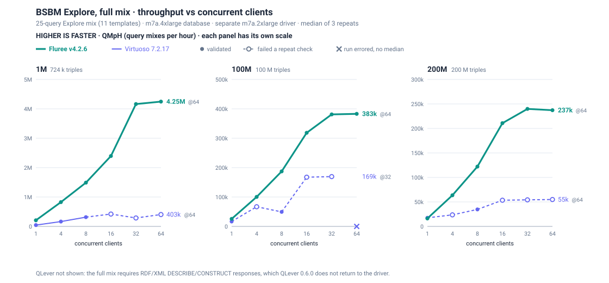
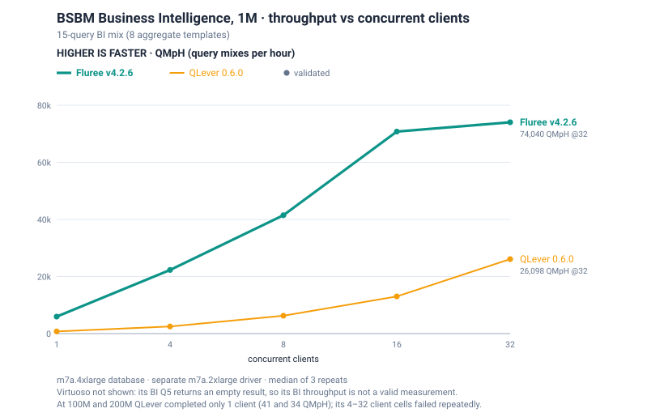

# BSBM — Berlin SPARQL Benchmark

**Fluree v4.2.8 completed every BSBM cell — Explore, the SELECT-only Explore subset,
Business Intelligence and Explore-and-Update at 1M, 100M and 200M triples — with zero
timeouts and zero driver errors.** At 100M triples, single-client Explore ran at
**47,375 QMpH** and peaked at **774,093 QMpH (5,376 queries/s)** with 32 clients, on one
AWS `m7a.4xlarge` (16 vCPU / 64 GiB) with fsync enabled. Measured November 19, 2026;
every figure is the median of three repeats.

[Summary grid](reports/v4.2.8/summary.tsv) ·
[Per-query latencies](reports/v4.2.8/per_query.tsv) ·
[Raw driver XML](reports/v4.2.8/runs/) ·
[Capacity protocol](capacity/README.md)

The [Berlin SPARQL Benchmark](http://wbsg.informatik.uni-mannheim.de/bizer/berlinsparqlbenchmark/)
(Bizer & Schultz) runs an **e-commerce** workload — products, vendors, offers,
reviews, reviewers — driven by BSBM's own Java test driver. Unlike
[SPARQLoscope](../sparqloscope/), which times fixed queries, BSBM measures
**throughput**: each client repeatedly runs a query mix whose templates are
re-instantiated with random parameters, and the driver reports **QMpH** (query
mixes per hour). QpS = QMpH × operations per mix / 3600.

## Compared with QLever and Virtuoso

**Fluree v4.2.8 had the highest validated throughput in every multi-client comparison
below.** On the SELECT-only Explore subset, Fluree's peak was **11.4×** Virtuoso 7.2.17's and
**86×** QLever 0.6.0's at 1M triples, and **4.5×** and **20×** at 100M. Single-client
results are closer: on the SELECT subset Fluree was 2.0× Virtuoso at 100M and 1.7× at
200M, and on the full Explore mix 1.75× Virtuoso at 200M.
**QLever was 59% faster** on single-client BI at 200M.

All three engines ran the same pinned driver, datasets, seed, timeout and query mixes on the
same host types: an `m7a.4xlarge` database and a separate `m7a.2xlarge` driver per scale,
every cell the median of three repeats. Fluree was measured November 19, 2026; QLever and
Virtuoso were measured in September 2026 and were not re-run.







Filled points passed every check: three repeats finished, per-query result counts were
identical across repeats, and the spread was 5% or less. Hollow points on dashed segments
have a median but failed a check; ✕ marks a cell where a repeat errored, so there is no
median. Every cell and its status are in [`comparison.tsv`](reports/v4.2.8/comparison.tsv).

QMpH; **bold = fastest in the row**; the client count of each peak is in parentheses.

**Explore SELECT subset**

| scale | cell | Fluree v4.2.8 | QLever 0.6.0 | Virtuoso 7.2.17 |
|---|---|--:|--:|--:|
| 1M | 1 client | **232,407** | 3,337 | 50,083 |
| 1M | peak | **5,034,353** (64) | 58,328 (32) | 443,024 (16) |
| 100M | 1 client | **48,658** | 2,831 | 24,161 |
| 100M | peak | **796,932** (32) | 40,022 (128) | 175,510 (64) |
| 200M | 1 client | **31,377** | 2,637 | 18,309 |
| 200M | peak | **497,843** (32) | 33,642 (128) | no validated cell above 1 client |

**Full Explore mix** (Virtuoso only; validated Virtuoso cells)

| scale | clients | Fluree v4.2.8 | Virtuoso 7.2.17 |
|---|--:|--:|--:|
| 1M | 1 | **204,947** | 45,245 |
| 1M | 8 | **1,500,977** | 314,279 |
| 100M | 1 | **47,375** | 16,724 |
| 100M | 8 | **348,043** | 49,395 |
| 200M | 1 | **30,629** | 17,515 |
| 200M | 8 | **231,066** | 34,659 |

**Business Intelligence**

| scale | clients | Fluree v4.2.8 | QLever 0.6.0 | Virtuoso 7.2.17 |
|---|--:|--:|--:|--:|
| 1M | 1 | **7,158** | 775 | incorrect results |
| 1M | 32 | **81,635** | 26,098 | incorrect results |
| 100M | 1 | **53.4** | 41.0 | failed |
| 200M | 1 | 21.2 | **33.8** | failed |

**Explore-and-Update, 1M** (every write fsynced before acknowledgement)

| cell | Fluree v4.2.8 | Virtuoso 7.2.17 |
|---|--:|--:|
| 1 client | **37,886** | 13,940 |
| peak | **88,464** (16) | 25,405 (8) |

Coverage and caveats:

- **Virtuoso.** Most Explore and SELECT cells at 16+ clients, and at 200M from 4 clients,
  returned different per-query result counts across repeats or spread more than 5%; the
  1M SELECT and 100M full-Explore 64-client cells had an errored repeat. Its BI Q5 returns
  an empty result for every product type at 1M, so its BI throughput is not equivalent
  work ([details](reports/engine-comparison/BI-Q5-CORRECTNESS.md)); BI at 100M and 200M
  did not complete (Q4 timeouts).
- **QLever.** The full Explore mix needs RDF/XML `DESCRIBE`/`CONSTRUCT` responses that
  QLever 0.6.0 does not return to the driver, so it runs only the SELECT subset. BI at
  100M and 200M completed only at 1 client; the 4–32 client cells failed repeatedly.
  Update was not run: durable fsync-before-acknowledgement updates have not been
  established for QLever 0.6.0. Its SELECT 200M 4-client cell spread 10.7%.
- **Fluree.** The 1M 8-client Update cell spread 9.3% across repeats and is drawn hollow;
  every other 1M Update cell, including the 16-client peak shown above, passed every check.
- **Client counts.** QLever's 100M and 200M SELECT sweeps include 128 clients because its
  64-client throughput beat 32 clients by more than 5%; Fluree's and Virtuoso's did not.
- **Reproduce.** Engine setup is pinned in [`engines/README.md`](engines/README.md).
  `python3 reports/v4.2.8/collect_comparison.py` rebuilds `comparison.tsv` from the run
  archives (QLever and Virtuoso rows are carried over when the archives are absent); `python3 reports/v4.2.8/make_comparison_charts.py` redraws the charts.

## Results — Fluree v4.2.8

### Explore — QMpH

The 25-query Explore mix (11 active templates) of product lookups, reviews and offers.

| clients | 1M | 100M | 200M |
|--:|--:|--:|--:|
| 1 | 204,947 | 47,375 | 30,629 |
| 4 | 817,713 | 189,057 | 123,062 |
| 8 | 1,500,977 | 348,043 | 231,066 |
| 16 | 2,431,297 | 605,596 | 402,975 |
| 32 | 4,361,363 | **774,093** | **492,762** |
| 64 | **4,518,756** | 763,188 | 483,006 |

Throughput scales to 32 clients and plateaus there: c64 is within 3.6% of c32 at
every scale, so the protocol's optional 128-client point was not run. Peak
queries/s: 31,380 (1M), 5,376 (100M), 3,422 (200M).

### Explore SELECT subset — QMpH

The Explore mix without its two RDF-returning templates (Q9 `DESCRIBE`, Q12 `CONSTRUCT`):
20 SELECT queries per mix. It is the common read mix for engines that cannot return the
RDF/XML the full Explore mix requires.

| clients | 1M | 100M | 200M |
|--:|--:|--:|--:|
| 1 | 232,407 | 48,658 | 31,377 |
| 4 | 912,921 | 195,385 | 124,247 |
| 8 | 1,702,772 | 358,713 | 233,831 |
| 16 | 2,769,240 | 636,627 | 413,220 |
| 32 | 4,932,204 | **796,932** | **497,843** |
| 64 | **5,034,353** | 789,626 | 490,047 |

c64 is within 2.1% of c32 at every scale; no 128-client point was needed. Peak
queries/s: 27,969 (1M), 4,427 (100M), 2,766 (200M).

### Business Intelligence — QMpH

The 15-query BI mix (8 analytic GROUP BY / aggregate templates). At 100M and 200M
several BI queries aggregate over most of the dataset, so absolute QMpH is low.

| clients | 1M | 100M | 200M |
|--:|--:|--:|--:|
| 1 | 7,158 | 53.4 | 21.2 |
| 4 | 26,364 | 146.6 | 66.4 |
| 8 | 48,059 | 281.7 | 128.6 |
| 16 | 78,709 | 487.0 | 234.9 |
| 32 | **81,635** | **697.0** | **328.6** |

At 200M, 32 clients run up to seven simultaneous copies of the heaviest BI query
(Q8 over `ProductType1`). Server RSS in that 32-client cell peaked at 24.6 GiB on the
64 GiB server.

### Explore-and-Update

The 30-operation mix interleaves Explore reads with five SPARQL Updates. Mixed
operations/s counts every read and write in the mix; it is **not write TPS**.
Every write is fsynced before acknowledgement. Each figure is the median of three
complete runs, each starting from a fresh copy of the imported store.

| scale | clients | QMpH | mixed ops/s | range (ops/s) |
|---|--:|--:|--:|--:|
| 1M | 1 | 37,886 | 315.71 | 315.34–317.86 |
| 1M | 4 | 65,960 | 549.67 | 545.92–557.35 |
| 1M | 8 | 79,659 | 663.83 | 609.64–671.28 |
| 1M | 16 | **88,464** | **737.20** | 728.10–746.56 |
| 1M | 32 | 84,265 | 702.21 | 700.30–723.63 |
| 1M | 64 | 79,791 | 664.93 | 659.41–680.09 |
| 100M | 1 | 10,848 | 90.40 | 80.12–96.29 |
| 200M | 1 | 6,388 | 53.23 | 42.29–59.01 |

At 100M and 200M, Update ran **three full runs at one client** — 400 measured mixes
(12,000 operations) per run — with no multi-client sweep at those scales:

| scale | run 1 | run 2 | run 3 | median | measured seconds per run |
|---|--:|--:|--:|--:|--:|
| 100M | 80.12 | 90.40 | 96.29 | **90.40** | 150 / 133 / 125 |
| 200M | 59.01 | 42.29 | 53.23 | **53.23** | 203 / 284 / 225 |

Mixed ops/s. These runs vary more than the read cells (coefficient of variation
9.2% at 100M, 16.5% at 200M). Peak server RSS was 31.3–31.8 GiB at 100M and
37.5–41.6 GiB at 200M.

### 100M single-client per-query latency

Median of the three repeats' average query execution times (ms). All scales,
workloads and client counts are in [`per_query.tsv`](reports/v4.2.8/per_query.tsv).

| Explore query | Q1 | Q2 | Q3 | Q4 | Q5 | Q7 | Q8 | Q9 | Q10 | Q11 | Q12 |
|---|--:|--:|--:|--:|--:|--:|--:|--:|--:|--:|--:|
| ms | 4.51 | 1.37 | 6.29 | 7.29 | 18.38 | 1.42 | 0.92 | 0.39 | 0.94 | 0.42 | 0.54 |

| BI query | Q1 | Q2 | Q3 | Q4 | Q5 | Q6 | Q7 | Q8 |
|---|--:|--:|--:|--:|--:|--:|--:|--:|
| ms | 3,029 | 89 | 3,083 | 1,779 | 12,964 | 82 | 2,059 | 15,946 |

## Validation

- **Completeness.** Every repeat of every cell finished with zero timeouts
  (300-second per-query cap) and no driver errors.
- **Repeatability.** Across three repeats, max − min is within 2.7% of the median for
  every Explore cell, 3.2% for the SELECT subset and 4.3% for BI. Update varies more:
  1M Update spread 0.8–9.3% (above 5% only at 8 clients), the 100M runs spread 17.9%
  and the 200M runs 31.4%. Every Explore, SELECT and BI cell returned identical per-query
  result-count summaries across its repeats.
- **BI Q7 row counts.** Q7 ranks products by offer count and keeps the top 1,000,
  with no tie-breaker, so correct executions can select different tied products and
  return different row counts. Row counts were identical across the three repeats of
  every BI cell here. Q7 responses from this release were not separately validated
  against an independently rebuilt answer set.
- **Update persistence.** After each Update run, the triple count was identical
  before and after a graceful restart (100M: 99,967,221; 200M: 199,998,114). These
  are graceful-restart checks, not power-loss tests.
- **Update triple counts.** The final counts equal the starting count plus the triples
  of the 800 measured insert payloads minus 10 triples for each effective offer delete.
  At 200M the count is exact with all 1,200 deletes effective (199,922,567 + 87,547 −
  12,000); at 100M one delete matched nothing (99,891,833 + 87,378 − 11,990). The insert
  payloads contain no duplicate triples and none already in the dataset. BSBM draws a
  delete's offer from a range that includes offers in payloads not yet inserted, and
  such a delete matches nothing. At 1M that is about 12% of deletes and depends on
  how clients interleave, so 1M final counts are identical across repeats up to 16
  clients and differ by 10–20 triples (one or two offers) at 32 and 64 clients.
- **Update result counts.** Per-query average result counts differed between some
  Update repeats (1M at 4+ clients).

## Method

Protocol details are in [`capacity/README.md`](capacity/README.md). In summary:

- **Hosts.** Database: AWS `m7a.4xlarge` (16 vCPU AMD EPYC, 64 GiB), 500 GB gp3
  (6,000 IOPS / 500 MiB/s), Ubuntu 24.04. The driver runs on a **separate**
  `m7a.2xlarge` in the same availability zone, one database/generator pair per scale.
  Only one measured workload runs per pair at a time, and each read cell starts a fresh
  server process followed by a triple-count check.
- **Driver.** bsbmtools v0.2 with a transport-only HTTP keep-alive patch
  (`capacity/prepare-driver.py`; query semantics unchanged), JDK 21, 24 GiB heap,
  seed 808080, 300-second query timeout.
- **Explore and SELECT subset.** A single-client qualification cell (1,000 warmup /
  100 measured mixes), then per client count 1,000 warmup mixes and a fixed mix count
  calibrated to about 180 seconds (minimum 120 s), three repeats at 1/4/8/16/32/64
  clients. Cells ran 147–191 seconds.
- **BI.** Two warmup mixes, then a fixed count of at least 2 × clients mixes, three
  repeats at 1/4/8/16/32 clients. Cells ran 137–706 seconds.
- **Mix counts.** The fixed per-cell mix counts are in the `measured_mixes` column of
  [`summary.tsv`](reports/v4.2.8/summary.tsv); they were calibrated with the pilot
  formulas in the capacity protocol. The counts carried over from earlier releases left
  the 100M and 200M Explore and SELECT cells, and the 1M BI 8-client cell, under the
  120-second minimum on v4.2.8, so those cells were recalibrated from v4.2.8's own
  throughput with the protocol's freeze formula and re-run; the published figures are
  the re-run cells.
- **Update.** Two mutating warmup mixes plus 400 measured mixes, three repeats. Each
  repeat restores an untouched store and runs a read preparation (1,000 warmup +
  100 measured SELECT mixes) first. Clients: 1/4/8/16/32/64 at 1M; 1 at 100M and 200M.
  The 100M/200M stores hold out 1,000 insert payloads (99,891,833 and 199,922,567
  starting triples).

### Build and environment

| | |
|---|---|
| Release | **Fluree v4.2.8** (`x86_64-unknown-linux-gnu`) |
| Server | `fluree server run --listen-addr 0.0.0.0:8182 --log-level warn` |
| Environment | `FLUREE_STORAGE_FSYNC=1`, `FLUREE_INDEXING_ENABLED=true`, `FLUREE_REINDEX_MIN_BYTES=2097152` (import and serving) |

### Datasets

Generated deterministically by bsbmtools v0.2 with forward chaining (`-fc`), N-Triples:

| scale | `-pc` | triples | SHA256 |
|---|--:|--:|---|
| 1M | 2,785 | 724,101 | `0eca9f19829be6390700196c5de4fe6e3d0610e1cd09d7f780de6526a95a48c8` |
| 100M | 284,826 | 100,000,748 | `9f72d493f1a8040558afdeb5b719dae9037625bb4911b36387a44746097707ba` |
| 200M | 570,000 | 200,031,975 | `6ded674926fe39153d557f2a059526723901edcea7232a8924bd7b49881936f8` |

### Other engines

QLever 0.6.0 and Virtuoso 7.2.17 results under this protocol are in
[Compared with QLever and Virtuoso](#compared-with-qlever-and-virtuoso); their pinned
setup is in [`engines/README.md`](engines/README.md). The June 2026
[engine comparison](reports/engine-comparison/REPORT.md) used older releases and an
earlier short-run protocol; it is kept for history and documents Virtuoso's incorrect
BI Q5 results.

## Run it

On the database host, from the repository root:

```bash
bash benchmarks/bsbm/setup-bsbmtools.sh
# 1M: bash benchmarks/bsbm/datasets/bsbm-1m/fetch-data.sh (writes datasets/bsbm-1m/td/).
# 100M shown; use -pc 570000 for 200M.
TD="$PWD/benchmarks/bsbm/datasets/bsbm-100m/td" && mkdir -p "$TD"
(cd benchmarks/bsbm/bsbmtools-0.2 && ./generate -fc -pc 284826 -s nt -dir "$TD" -fn "$TD/dataset")
python3 benchmarks/bsbm/engines/check-dataset.py 100m "$TD/dataset.nt" --output dataset-100m.json

export FLUREE_STORAGE_FSYNC=1 FLUREE_INDEXING_ENABLED=true FLUREE_REINDEX_MIN_BYTES=2097152
fluree init && fluree create bsbm --from "$TD/dataset.nt"
ulimit -n 1048576 && fluree server run --listen-addr 0.0.0.0:8182 --log-level warn
```

On the separate generator (same dataset and `td/` directory), build the keep-alive
driver once, then run cells:

```bash
python3 benchmarks/bsbm/capacity/prepare-driver.py
export BSBM_DATA="$PWD/benchmarks/bsbm/datasets/bsbm-100m/td" DB=http://DB_PRIVATE_IP:8182

python3 benchmarks/bsbm/capacity/run-cell.py --engine fluree --data "$BSBM_DATA" \
  --endpoint "$DB/v1/fluree/query/bsbm:main" \
  --workload explore --clients 32 --warmups 1000 --runs 39200 \
  --output results/fluree-100m-explore-c32-r1

python3 benchmarks/bsbm/capacity/run-cell.py --engine fluree --data "$BSBM_DATA" \
  --endpoint "$DB/v1/fluree/query/bsbm:main" \
  --update-endpoint "$DB/v1/fluree/update/bsbm:main" \
  --workload update --clients 1 --warmups 2 --runs 400 --minimum-seconds 0 \
  --output results/fluree-100m-update-c1-r1
```

`--runs 39200` is the calibrated 100M c32 count; use `--workload select` for the SELECT
subset. Calibrate other cells with the pilot formulas in the
[capacity protocol](capacity/README.md), which also covers BI, store snapshots for
Update and telemetry. The ledger-scoped query endpoint returns
`application/sparql-results+xml`, and the update endpoint accepts form-encoded
`update=…`; the driver talks to Fluree directly, with no adapter.

## Layout

```
setup-bsbmtools.sh       fetch + verify the pinned BSBM toolkit (generator + driver)
datasets/<scale>/        DATASET.md + fetch-data.sh (deterministic generator)
capacity/                sustained-throughput protocol, keep-alive driver, run-cell.py
engines/                 pinned Virtuoso / QLever setup for cross-engine runs
parse_bsbm_xml.py        benchmark_result.xml -> querymix_summary.tsv + per_query.tsv
run-*matrix.sh           earlier short-run sweeps (superseded by capacity/)
reports/v4.2.8/          summary.tsv, per_query.tsv, runs/<scale>/<workload>__c<N>__r<R>.xml
                         comparison.tsv (+ collect_comparison.py, make_comparison_charts.py)
reports/engine-comparison/  June 2026 cross-engine comparison (older releases)
```

## Provenance

- BSBM: <http://wbsg.informatik.uni-mannheim.de/bizer/berlinsparqlbenchmark/>
- Toolkit: bsbmtools v0.2 (Freie Universität Berlin), pinned in `setup-bsbmtools.sh`
  (SourceForge `bsbmtools-v0.2.zip`, sha256 `40f5e59b…`). Ships a prebuilt
  `lib/bsbm.jar` that runs on a modern JRE — no rebuild (its `build.xml` targets
  `-source 6`, which JDK 9+ rejects).
